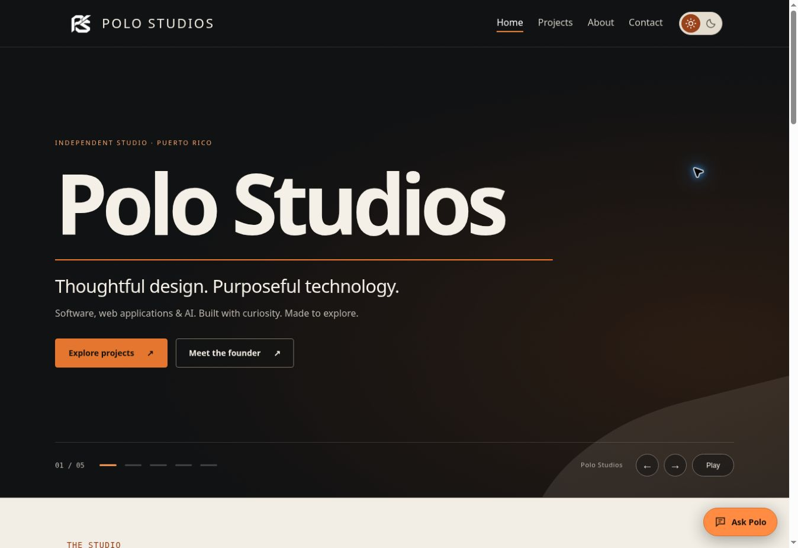

# Polo Studios

**Independent technology studio and developer portfolio by Miguel A. De Jesus, based in Puerto Rico.**

[Visit the portfolio](https://pologram1.github.io/POLO-TECH/) · [Projects](https://pologram1.github.io/POLO-TECH/projects.html) · [Contact](https://pologram1.github.io/POLO-TECH/contact.html)

[](https://github.com/pologram1/POLO-TECH/actions/workflows/portfolio.yml)



## Overview

Polo Studios brings together my software projects, technical learning, and creative interests. This repository contains the multi-page portfolio, project case studies, a browser-based search assistant, and Casino Simulator. I am a computer engineering student with an expected graduation in May 2027, open to internships and job opportunities.

## Explore the work

| Project | What it demonstrates | Location |
| --- | --- | --- |
| Fragrance Library | Collection management, exact bottle valuation, and Supabase account saving. | [App](https://pologram1.github.io/fragrance-library/) · [Source](https://github.com/pologram1/fragrance-library) |
| MiniAmazon | E-commerce workflows and separate Java/JSP/MySQL backend. | [Demo](https://pologram1.github.io/Mini-Amazon-WebPage/) · [Source](https://github.com/pologram1/Mini-Amazon-WebPage) |
| OGNETFLIX | Movie queues, rental lifecycle, and administrator tools. | [Demo](https://pologram1.github.io/OGNETFLIX/) · [Source](https://github.com/pologram1/OGNETFLIX) |
| FRAS | Simulated professor and administrator attendance workflows. | [Prototype](https://pologram1.github.io/FRAS-Demo/) · [Source](https://github.com/pologram1/FRAS-Demo) |
| Polo Studios AI Assistant | Public project search with optional on-device semantic matching. | [Open](https://pologram1.github.io/POLO-TECH/assistant/) · [Guide](assistant/README.md) |
| Casino Simulator | Virtual-money game rules, balance validation, and transaction history. | [Demo](https://pologram1.github.io/POLO-TECH/casino/) · [Guide](casino/README.md) |

## Architecture and code map

| Path | Purpose |
| --- | --- |
| `index.html`, `projects.html`, `about.html`, `contact.html` | Public portfolio pages. |
| `ognetflix.html` | Movie-rental project case study. |
| `styles.css`, `theme.js`, `script.js` | Shared presentation, saved theme preference, and interactions. |
| `assistant/` | Search UI, public knowledge records, optional semantic worker, and tests. |
| `casino/` | JavaScript game demo, Java console implementation, and domain tests. |
| `assets/`, `downloads/` | Visual identities, images, and public downloads. |
| `.github/workflows/` | Automated portfolio and casino checks. |

The portfolio is static HTML/CSS/JavaScript served by GitHub Pages. The assistant answers from public project records; optional semantic search loads a model on the visitor’s device. It does not access private accounts or execute project actions.

## Run locally

```sh
git clone https://github.com/pologram1/POLO-TECH.git
cd POLO-TECH
python3 -m http.server 8000
```

Open `http://localhost:8000`. A local server is recommended for modules and worker assets.

## Validation

With Node.js 22:

```sh
node --test theme.test.js assistant/tests/*.test.js
npm test --prefix casino
```

The portfolio workflow checks theme behavior, assistant routing/search, and public knowledge links. The casino workflow separately tests browser game rules and compiles/tests the Java console version.

## Contribution and credits

**Miguel A. De Jesus:** founder of Polo Studios and author of the portfolio and individual software projects presented here. **OGNETFLIX and FRAS** are collaborative academic projects with **Ricardo J. Lopez Ortiz**; their repositories identify the shared scope. Third-party brands, posters, product imagery, and libraries retain their respective ownership.

## Current status

The portfolio and assistant are live. Casino Simulator uses virtual funds only. FRAS recognition is simulated; each linked repository describes its own working features, dependencies, and unfinished work. Planned integrations should not be described as implemented.

[LinkedIn](https://www.linkedin.com/in/miguel-de-jesus-118569241) · [Email](mailto:themiguel10101@gmail.com)
