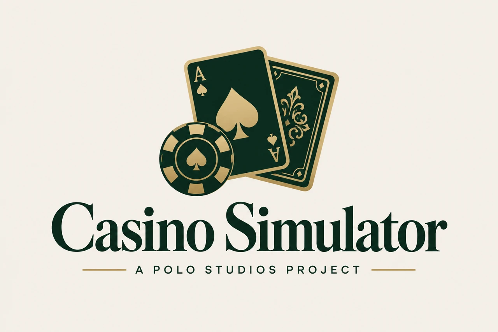

# Casino Simulator

### A Polo Studios Project



A small portfolio project by Miguel A. De Jesus for Polo Studios. Includes a playable browser application and a dependency-free Java console implementation. Created October 21, 2026. This is a newly built portfolio implementation; it does not claim to be the original academic source archive.

**[Play the browser demo](https://pologram1.github.io/POLO-TECH/casino/)** · **[Project overview](https://pologram1.github.io/POLO-TECH/projects.html#casino)**

## What it demonstrates

- Object-oriented account and game models, integer credit balances, and input validation.
- Slots, random outcomes, bet limits, and explicit payout rules.
- Browser blackjack with Hit / Stand, flexible aces, a hidden dealer hole card, natural 3:2 payouts, and hands that survive refresh.
- A High / Low dice game.
- Deposits to a bank balance, withdrawals to a playing balance, and transaction history.
- A player name and browser-local automatic saving. Java sessions remain in memory.
- Responsive UI, keyboard-accessible tabs, status announcements, and reduced-motion support.

This simulation uses free virtual credits with no monetary value. It does not accept payments or award cash prizes. Every fresh account starts with 200 playing credits and 800 bank credits. Bank transfers conserve the total; only game results change it. Reset clears the local session.

The browser has three games (slots, dice, and blackjack). The Java console companion implements slots and dice.

## Rules

Returns include the original bet. Slots and dice bets are whole credits from 1 to 100, within the available playing balance. Blackjack uses even bets from 2 to 100 so a 3:2 natural payout remains a whole number of credits.

| Game | Outcome | Total return |
| --- | --- | --- |
| Slots | Three matching symbols | 8 x bet |
| Slots | Exactly two matching symbols | 1 x bet |
| Slots | No matching symbols | 0 |
| Dice | Low (1-3) or High (4-6) chosen correctly | 2 x bet |
| Dice | Incorrect choice | 0 |
| Blackjack | Natural two-card 21, dealer without blackjack | 2.5 x bet (3:2 profit) |
| Blackjack | Ordinary win | 2 x bet |
| Blackjack | Push (tie, including both natural) | 1 x bet |
| Blackjack | Loss or bust | 0 |

Blackjack uses a new shuffled 52-card deck each hand. Cards are drawn without replacement. Aces count as 11 until reducing them to 1 is needed to avoid busting; face cards count as 10. Dealer checks for a natural, then stands on all 17s including soft 17. Reaching 21 after a hit automatically stands. No split, double, insurance, or surrender. The bet is reserved at deal time and a hand settles once. Complete the hand before changing games or transferring credits; refreshing restores the cards and reserved stake. Reset starts a fresh virtual session.

Slots have 125 equally likely combinations: 5 triples, 60 pairs, and 60 unmatched. The expected total return is 80% of the stake. Dice pays evenly at a 50% chance. Each round is independent. Browser randomness uses rejection-sampled Web Crypto integers; Java uses SecureRandom.

## Run locally

Browser: serve the repository using `python3 -m http.server 8000`, then open `/casino/` when working from the Polo Studios repository, or `/` when serving this folder directly. JavaScript modules require HTTP rather than opening the file directly.

Java 17 or newer:

```sh
javac -d build casino/java/CasinoGame.java casino/java/CasinoGameTest.java
java -cp build CasinoGameTest
java -cp build CasinoGame
```

From this folder, omit the `casino/` prefix. Commands include `slots 10`, `dice 10 high`, `deposit 100`, `withdraw 100`, `history`, and `quit`.

## Verify

```sh
cd casino
npm test
```

Tests cover insufficient funds, invalid inputs, transfers, settled bets, every slot combination, blackjack naturals, busts, pushes, dealer play, and restored browser sessions including unfinished hands. The repository workflow also compiles and checks the Java version.

## Scope

The browser demo mirrors the Java game rules using JavaScript; GitHub Pages serves static content and does not execute Java. The virtual bank is a teaching model with no authentication, payment integration, or shared financial accounts. Browser storage can be cleared or modified by the visitor.
